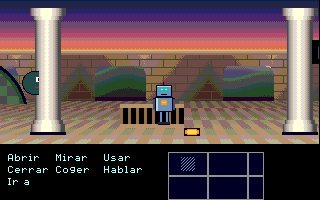

# ScummNext: SCUMM para ZX Spectrum Next

Un intérprete de aventuras **SCUMM v5** para el ZX Spectrum Next, escrito en
ensamblador Z80N. Con él se juega en el Next a *The Secret of Monkey Island* en
su versión CD/VGA, de principio a fin, **con los ficheros de tu propia copia del
juego**. Funciona igual que ScummVM: aquí solo está el motor. Los gráficos, los
textos y la música salen de tu CD y no se incluyen ni se reparten.

**Descarga:** el motor y el conversor para Windows, listos para usar, están en
[Releases](../../releases) (`ScummNext-AAAAMMDD.zip`, con su `LEEME.txt`).

Lo que hace ya:

- **Arranca el juego desde su script de inicio**, como el original: la
  introducción (que se salta con ESC) y después se juega, con el ratón o el
  teclado.
- **Los verbos, las frases y el inventario**. La barra de verbos (de texto o
  con imagen), el verbo bajo el cursor resaltado, la línea de frase que montan
  los scripts del juego y el script de frases, que ejecuta "abrir puerta" o
  "usar llave con puerta". Los clics y las teclas llegan al script de verbos
  del juego igual que en SCUMM. El inventario tiene sus iconos, y los objetos
  se cogen y se usan con sus propios scripts.
- **Los textos, con las fuentes del juego**: lo que dice cada actor, encima de
  él y con su color, con saltos de línea y la espera que toca según lo largo
  que es (el punto la corta), y los textos fijos en cualquier parte de la
  pantalla.
- **Carga cada habitación y cada costume desde la tarjeta SD**, con las
  llamadas de esxDOS. Los ficheros los prepara un conversor en el PC.
- **Fondo en Layer 2 de 320x256 a 256 colores**, con la paleta de cada
  habitación. Las habitaciones más anchas que la pantalla hacen **scroll**
  con el registro de Layer 2. Cada paso de cámara (8 píxeles, como en el
  original) copia una sola tira nueva de 8x144 píxeles. Debajo, con un corte
  del copper, la zona de verbos y del inventario, que no se mueve.
- **Todos los actores de la habitación, con sprites por hardware**. En cada
  paso, el Z80 decodifica los miembros de cada costume (el RLE original del
  juego) en tiles de 16x16, en un lienzo de hasta 128x128 píxeles por actor.
  Los costumes de 16 colores van en sprites de 4 bits y los de 32 colores, en
  sprites de 8 bits. Cada actor queda **tapado por los planos Z** de la
  habitación según la caja en la que está, se dibuja con su escala y su
  elevación, y los de delante (más abajo en la pantalla) tapan a los de atrás,
  en el mismo orden que SCUMM. **Cada actor es como en ScummVM**: anda por
  las cajas, con sus fotogramas de andar, estar quieto y hablar, sus
  animaciones (`animateActor`), su velocidad, sus colores, su escala, su plano
  Z fijo o sin cajas si el script lo pide, y el sonido que llevan algunas
  animaciones (pasos, golpes: el comando de sonido del costume pone el que el
  script le dio al actor); y su costume se carga de la SD cuando hace falta.
- **Escalado**: en las habitaciones con perspectiva, la caja dice la escala
  del actor. Puede ser fija o salir de una franja que va de una escala a otra
  según la altura (el bloque SCAL). El actor se dibuja más pequeño y anda más
  despacio, como en el original.
- **Objetos según su estado**: puertas, cosas que se cogen... Cada uno tiene
  una imagen por estado y puede depender de otro objeto (su padre). Al
  cambiar el estado se rehacen las tiras que toca, incluidos sus planos Z.
- **Andar como en SCUMM**: las cajas de la habitación, el punto más cercano, el
  camino de caja en caja (la matriz BOXM), los giros de 90 en 90 grados y las
  animaciones de andar y de estar quieto. Es una traducción del código de
  SCUMM v5 tal como lo documenta ScummVM. Cuando un script desactiva cajas y
  pide los caminos otra vez (`createBoxMatrix`, en las catacumbas de Monkey
  Island cada vez que cambian los túneles), la matriz se rehace como en
  ScummVM: el conversor deja en cada habitación qué cajas se tocan (un bit por
  pareja) y el Z80 busca el camino más corto entre las que siguen activas. Sin
  eso, el protagonista cruzaba cajas desactivadas, por donde no hay suelo.
- **La cámara sigue al actor** igual que en el original, y los scripts la
  pueden mover, fijar o pasar a otro actor.
- **Efectos de paleta y de pantalla**: cambiar un color (`setPalColor`),
  oscurecer o teñir la habitación partiendo de su paleta original
  (`roomIntensity` y `rgbRoomIntensity`), los ciclos de color de cada
  habitación (agua, fuego...), el temblor de la pantalla y las transiciones al
  cambiar de habitación: de golpe, disolviendo en bloques de 8x4 o con el iris,
  como en el original, gracias a una segunda pantalla de Layer 2.
- **Los scripts del juego**: una máquina virtual de SCUMM v5 que entiende las
  instrucciones del juego. Al entrar en una habitación se ejecuta su script de
  entrada, y los scripts que este arranca siguen en marcha. Así los objetos
  toman el estado que les dan los scripts, la cámara se coloca o se desplaza,
  se cambian los límites del scroll y las cajas por donde se puede andar, o se
  pasa a otra habitación. Al salir, el script de salida.
- **Guardar y cargar la partida**, en ocho huecos (`SAVE1.DAT` a `SAVE8.DAT` en
  la SD), desde un menú propio del intérprete (como el F5 de la versión CD). Al
  cargar se vuelve a la habitación tal como estaba: scripts, objetos,
  inventario, actores, cámara, paleta y verbos. También reiniciar el juego y
  salir (`systemOps`), desde el menú o cuando lo piden los scripts.
- **Las variables que pone el motor al empezar**, las mismas que ScummVM
  (vídeo VGA, ratón, la 74 que comprueba Monkey Island al arrancar...).
- **Sonido**: los efectos digitalizados del juego (los de Sound Blaster) y la
  música del CD. Cada sonido del juego puede traer varias versiones (digitalizada,
  AdLib, Roland, altavoz del PC); el conversor coge la digitalizada si la hay, como
  ScummVM. Dentro de un sonido el tamaño de cada versión no cuenta su cabecera (al
  revés que en el resto del fichero): hasta el 27-10-2026 el conversor lo leía mal,
  solo veía la primera versión, y 13 sonidos de Monkey Island con versión
  digitalizada (puertas, entre otros) no sonaban. Los efectos que se repiten
  (iguales byte a byte) se guardan una vez: Monkey Island tiene 62 en 386 KB.
  Los que solo existen para AdLib (musica de iMuse para el chip FM OPL2, que el
  Next no tiene) se sintetizan al convertir: `tools/adlib.py` los toca como
  ScummVM (el reproductor de iMuse y su driver de AdLib, con sus envolventes) y
  `tools/opl2.py` es un OPL2 propio en Python, sin nada de fuera. Quedan como
  efectos a 6863 Hz; los que iMuse repite para siempre (una nota sostenida y un
  salto), con un trozo de medio segundo que da vueltas (con un fundido para que no
  se oiga el salto) o, si es una melodia, la vuelta entera. Entran los que caben
  en el sitio que dejan los efectos digitalizados, de menor a mayor; el conversor
  avisa de los que no (en Monkey Island, solo una melodia de 5 s). Para los
  scripts suenan lo que dura su pista, o hasta que se paran, como en ScummVM; si se
  piden otra vez, empiezan de nuevo; y al cargar una partida siguen (iMuse se
  guarda con ella). Los WAV de `build/adlib_wav` (si se generan) sirven para
  compararlos de oido con ScummVM. Los efectos se cargan al arrancar y suenan por el DAC A+D, dos a
  la vez: cada uno en su canal (CTC 0 y CTC 2, cada uno a su ritmo), y el DAC
  lleva la suma de las dos últimas muestras, recortada (con uno solo suena igual
  que antes). Uno nuevo va al canal libre o, si suenan los dos, al que antes iba
  a acabar. En Monkey Island casi la mitad de los efectos empiezan con otro
  sonando (sobre todo los golpes de espada de los duelos): antes se cortaba la
  cola del anterior, y en algunas escenas efectos enteros de 1 o 2 segundos. La
  música son las pistas de tu CD, convertidas a 8 bits y 11025 Hz, que se leen
  de la SD mientras se juega y suenan por los DAC B y C con el CTC 1 (todo con
  el IM2 de hardware del Next). La de
  la música solo lee el siguiente byte de un buffer de 255 en la memoria
  principal (`$BD01`), sin cambiar de página: la interrupción de línea lo llena
  desde el anillo una vez por imagen. El DMA no las retrasa: todo lo que va por
  DMA (las copias del programa y la subida de los sprites) va a trozos de 256
  bytes, que duran menos que una muestra, y el CTC no para el DMA (registro `$CD`
  a 0): lo que pide espera al final del trozo. Antes el CTC podía parar la subida
  de los sprites; pero después de cada
  RETI el programa empieza una instrucción antes de que el DMA vuelva a por el
  bus, y con muchas muestras seguidas (la música y un efecto, como en los duelos a
  espada) llegaba con la subida a medias al `OUT` de `$303B` o al DMA siguiente:
  tiles con lo del paso anterior (comprobado en un Next: a trozos ya no salen). La
  música **no se para al cambiar de habitación**: la SD se lee con las
  interrupciones puestas y, entre página y página de la habitación, se lee
  también un trozo de la pista. Lo que ven los scripts (si un sonido sigue
  sonando, el reloj de la música) es como en ScummVM. Los efectos de 6849 Hz
  (más de la mitad de los de Monkey Island) pedirían al CTC una constante de 256,
  que se escribe 0; con un 0, el CTC 0 de CSpect interrumpe sin parar y el
  programa se queda quieto con las interrupciones cortadas, así que el Z80 la
  cambia por 255 (6863 Hz). Eso colgaba el juego en un Next al entrar en la
  cocina del bar, donde suena el primer efecto de la partida; con el 255 ya no
  se cuelga (comprobado en un Next). `tools/mustest.py sfx` lo reproduce en
  CSpect con el juego de prueba.



El GIF es del **juego de prueba** que trae el proyecto (`python tools/run.py
cspect prueba` lo abre): el patio, el robot, las fuentes y los iconos están
dibujados con código en `tools/fixture.py` y `tools/fixture_ui.py`. Una
tortuga pasea por el patio y otra lo prueba todo: se gira, va hasta el robot,
habla, anda sin cajas, cambia de escala... Se salta la escena del principio con ESC, se mira
el farol, se abre la puerta (y la pantalla tiembla), se coge
la moneda (que pasa al inventario con su icono y un nombre nuevo), se mira la
moneda en el inventario, se habla con el sol (contesta la tortuga) y se mira
el sol, y el patio se tiñe de atardecer. El sol parpadea todo el rato con un
ciclo de color. Son capturas de ZEsarUX, y cada fotograma se ha comprobado píxel a
píxel contra el modelo de referencia.

## Usarlo con tu Monkey Island

Necesitas los ficheros `MONKEY.000` y `MONKEY.001` de tu CD (la versión CD/VGA
usa SCUMM v5). Ponlos en `original/`, con las pistas de música si las tienes
(más abajo), o usa directamente una imagen del CD (más abajo también). En
Windows también se puede hacer todo con una ventana: mira
[El conversor con ventana](#el-conversor-con-ventana-windows).

```bash
python tools/build.py
python tools/convert.py original MONKEY build/sd
python tools/run.py
```

El primer comando ensambla el motor y lo deja en `build/sd/scumm.nex`. El
segundo crea en `build/sd`:

- `GAME.DAT`, la lista de habitaciones y de costumes;
- un `Rnnn.DAT` por habitación (con sus scripts) y un `Cnnn.DAT` por costume;
- `SCRIPTS.DAT`, los scripts globales, y `OBJ.DAT`, el dueño, el estado y las
  clases de cada objeto al empezar;
- `CHARS.DAT`, las fuentes del juego;
- `VERBIMG.DAT`, las imágenes de los verbos (los iconos del inventario son
  objetos de otra habitación);
- `INVOBJ.DAT`, lo que hace falta de cada objeto cuando está en el inventario
  (sus verbos, su código y su nombre), porque su habitación ya no está cargada;
- `SOUNDS.DAT`, los efectos digitalizados y, de cada sonido, lo que dura
  (para las pistas del CD, sale del audio de la pista);
- un `Tnn.DAT` por pista del CD que usa el juego: la música, en 8 bits mono a
  11025 Hz (unos 30 MB), subida de volumen (el CD va flojo: x 2,5 con un
  limitador suave para que los picos no se recorten). Las pistas tienen que estar en la misma carpeta que
  `MONKEY.000`, como `Track1.fla` ... `Track24.fla` (FLAC, como las deja
  ScummVM) o `.wav`. Para los FLAC hace falta el paquete `soundfile` de
  Python (`pip install soundfile`; o, sin tocar tu Python,
  `pip install --target build/pylib --no-deps soundfile cffi pycparser`).

Con el CD son 83 habitaciones y 119 costumes, unos 12 MB, más el sonido (unos 31 MB). El tercero abre
CSpect con esa carpeta como tarjeta SD (`python tools/run.py zesarux` abre
ZEsarUX). Para un Next de verdad, copia todo `build/sd` a una carpeta de la SD
y abre `scumm.nex` desde el navegador. Hace falta un Next de 2 MB.

**`original/` y `build/sd` llevan los gráficos y los textos de tu juego: son
para tu uso, no para repartirlos.**

### Desde una imagen del CD

En lugar de la carpeta se le puede dar la imagen del CD: el conversor saca de
ella `MONKEY.000`, `MONKEY.001` y la música de las pistas de audio, sin
programas aparte ni ficheros que renombrar (`tools/cdimage.py`).

```bash
python tools/convert.py "Monkey Island.cue" MONKEY build/sd
```

Entiende `.cue` con sus `.bin`, `.img` o `.wav` (uno para todo el disco o uno
por pista), CloneCD (`.ccd` con su `.img`) e `.iso`. Si se le da el `.bin`,
`.img` o `.iso` y al lado está su `.cue` o `.ccd`, lo usa. Un `.iso`, o un
`.bin` o `.img` sin hoja, solo tiene los datos: sin música, salvo que estén al
lado los `TrackN.flac`. Cada pista va de su `INDEX 01` al principio de la
siguiente, sin los 2 segundos de silencio que las separan, y la pista *n* del
juego es la *n*+1 del disco, como en ScummVM con el CD de verdad. No entiende
`.mds`/`.mdf`, `.nrg` ni `.chd`: hay que pasarlos antes a `.cue`/`.bin`.

El juego empieza por su script de inicio, como en el original. Para ver qué
hay en los ficheros:

```bash
python tools/convert.py original MONKEY --list
```

Esto lista las habitaciones (tamaño y cajas) y los costumes (tamaño,
animaciones y colores), y dice si el juego cabe en el Next.

Para que el menú de partidas diga por dónde va cada una hace falta además
`PROGRESO.DAT`, que sale de una partida grabada entera con `tools/partida.py`
(la de las pruebas llega a los créditos):

```bash
python tools/progreso.py zx_creditos build/sd
```

Tarda unos 3 minutos: juega la partida en el modelo y apunta qué variables
cambian y cuándo. Solo lleva números (qué variables mirar y cuántas hay en cada
momento), pero sale de tu juego, como lo demás de `build/sd`. Sin ese fichero,
el menú no enseña el %.

### Varios juegos en la tarjeta

Cada juego convertido puede ir en su carpeta, junto a `scumm.nex`; `--titulo`
pone el nombre que sale en el menú (en `TITULO.TXT`; sin él, el de la carpeta).
**La carpeta tiene que tener un nombre corto, de 1 a 8 letras o cifras**: el menú
lee la tarjeta con nombres 8.3, y una carpeta como `MonkeyIsland` no sale en la
lista (en ZEsarUX no aparece). El nombre largo va en el título:

```bash
python tools/convert.py original MONKEY TARJETA/MONKEY --titulo "Monkey Island"
python tools/convert.py otro_cd ATLANTIS TARJETA/ATLANTIS --titulo "Fate of Atlantis"
```

```
scumm.nex
MONKEY/      GAME.DAT, R001.DAT, ..., TITULO.TXT, SAVE1.DAT
ATLANTIS/    ...
```

Si hay más de uno, al arrancar sale la lista: se elige con su cifra (1-9) o
con el ratón y se empieza con ENTER o el botón. Un juego suelto junto a
`scumm.nex` (como al principio) también sale, como «El juego de esta carpeta»;
si solo hay uno, arranca directamente, sin menú. Las partidas guardadas de cada
juego van en su carpeta. Desde el menú de partidas, **J** vuelve a la lista para
cambiar de juego (ESC sigue con el de ahora; lo no guardado se pierde al cambiar).
La lista usa una letra propia de 5 x 7 (`tools/menufont.py`), porque antes de
elegir no hay fuentes del juego cargadas.

El menú carga cualquier juego convertido, pero el conversor y el motor solo
entienden SCUMM v5, y solo Monkey Island 1 (CD) está probado: otro juego v5
saldría en la lista, pero lo más probable es que no funcione bien.

Al acabar, el conversor dice si el juego cabe en el Next («todo cabe en el
Next») o qué no cabe y por cuánto. Algunos límites: los scripts globales en
128 KB, 1000 objetos, 448 KB de efectos, 16 KB de fuentes, 24 KB para el
costume del protagonista, 51 páginas y 128 tiras de ancho por habitación. La
tabla entera, con dónde los pone el código del Next, está al principio de
`tools/convert.py`. Si algo no cabe, escribe los ficheros igual pero sale con
error, porque en el Next eso fallaría sin avisar: se corta un fichero, se pierde
lo que sobra o se para con el borde rojo. `--list` lo dice sin escribir nada.
Monkey Island 1 cabe, pero justo: sus scripts ocupan 127 083 bytes de 131 072 y
tiene 1000 objetos, el máximo.

### El conversor con ventana (Windows)

`ConversorScumm.exe` hace lo mismo que `tools/convert.py`, sin consola ni
Python, y además enseña lo que ya hay preparado para la tarjeta. Se hace con

```bash
python tools/build_exe.py
```

que deja `build/exe/ConversorScumm.exe` (unos 25 MB, con el `scumm.nex` del
último `tools/build.py` dentro; hace falta PyInstaller). No lleva nada de ningún
juego: cada uno lo saca de su original. Sin empaquetar, es `python tools/gui.py`.

Se trabaja sobre una carpeta (de serie, `Documentos\ScummNext`) que al final se copia
entera a la SD del Next; desde el Next se abre su `scumm.nex` y sale la lista:

```
ScummNext/
  scumm.nex
  MONKEY/      GAME.DAT, ..., TITULO.TXT, CONVERSION.JSON, SAVE1.DAT
  ATLANTIS/    ...
```

- Arriba, la carpeta y si su `scumm.nex` es el que trae el programa («al día»),
  otro o ninguno; «Copiar el motor» pone el suyo (al convertir, si falta, lo
  copia solo).
- A la izquierda, los juegos de la carpeta por el nombre del menú (caben 9) y
  su estado: listo, no cabe en el Next, sin informe (convertido a mano, sin
  `CONVERSION.JSON`) o carpeta larga (el Next no lo vería).
- A la derecha, el juego elegido: el nombre en el menú (se cambia y «Guardar»
  reescribe `TITULO.TXT`), la carpeta, de dónde salió, lo que ocupa, si tiene
  `PROGRESO.DAT`, sus partidas guardadas y el informe de la conversión.
  «Reconvertir» lo repite (con un `scumm.nex` o un conversor nuevos);
  «Quitar…» manda la carpeta a la papelera.
- «Convertir un juego…» pide el original: la carpeta (donde estén `.000` y
  `.001`, y las pistas del CD) o la imagen del CD (`.cue`, `.ccd`, `.iso`,
  `.img` o `.bin`, con «Imagen de CD…»). Dice qué juego es (versión, habitaciones,
  pistas encontradas) y deja elegir el nombre del menú (hasta 31 letras), la
  carpeta en la SD (hasta 8, en mayúsculas), si llevar la música, el
  protagonista y la primera habitación (como `--costume` y `--room`) y un
  `PROGRESO.DAT`. «Comprobar si cabe» lo mira sin escribir nada.

Convierte en una carpeta aparte (`.convirtiendo_MONKEY`) y solo cuando acaba
bien cambia los ficheros del juego, así que si se para o falla queda lo de
antes. Las partidas (`SAVEn.DAT`) y el `PROGRESO.DAT` de la carpeta se
conservan. Una tarjeta de antes, con el juego suelto junto a `scumm.nex`, sale
como «El juego de esta carpeta», y «Pasar a su carpeta…» lo mueve a una carpeta
propia con sus partidas.

## Controles

| Tecla                            | Acción                                         |
|----------------------------------|------------------------------------------------|
| Ratón (Kempston)                 | Mover el cursor                                |
| CAPS SHIFT + 5 6 7 8             | Mover el cursor con el teclado                 |
| Botón izquierdo o ENTER          | Clic                                           |
| Botón derecho o CAPS SHIFT + ENTER | Clic con el botón derecho                    |
| Letras y cifras                  | Las teclas del juego (cada verbo tiene la suya)|
| CAPS SHIFT + SPACE               | ESC: saltar una escena                         |
| SYMBOL SHIFT + M                 | `.`: cortar lo que se está diciendo            |
| SYMBOL SHIFT + N C J Z           | `,` `?` `-` `:`                                |
| CAPS SHIFT + 0                   | Borrar                                         |
| CAPS SHIFT + letra               | La letra en mayúscula                          |
| CAPS SHIFT + 1                   | Menú de partidas                               |
| CAPS SHIFT + 2                   | Medidor: décimas de imagen que tarda cada paso (media de 10; el paso tiene 50 a 10 pasos por segundo y 50 Hz) |

En el menú de partidas: **1-8** elige el hueco, **G** guarda, **C** carga,
**R** reinicia el juego, **S** sale (el Next se reinicia), **J** cambia de juego
(si hay más de uno en la tarjeta) y **ESC** (CAPS SHIFT + SPACE) vuelve al juego.

Al guardar se le pone un nombre de hasta 24 letras: letras, cifras, espacio y
`. , ? - :` con SYMBOL SHIFT; CAPS SHIFT + 0 borra la última, ENTER guarda y ESC
vuelve sin guardar. Si el hueco ya tenía nombre sale escrito: ENTER lo deja, y
la primera letra que se escribe lo cambia entero. Cada hueco enseña su nombre
(o la habitación, si no tiene, como las partidas de antes), en gris, y el
elegido en amarillo. El nombre va en la
cabecera de `SAVEn.DAT`, en bytes que antes se guardaban a cero, así que las
partidas viejas siguen cargando.

El menú escribe con la letra de 5 x 7 del menú de juegos, no con una fuente
del juego: así mide siempre lo mismo (antes usaba la que tuviera puesta el
juego, y con la grande de los títulos no cabía). Mientras está abierto, el
scroll y el temblor de Layer 2 se ponen a 0, y al salir vuelven a como estaban.

Si en la carpeta del juego hay un `PROGRESO.DAT`, el menú dice además por dónde
va cada partida (un % hasta que empiezan los créditos del final), y arriba, la
que se está jugando.
Es aproximado: sale de una partida grabada entera (`tools/progreso.py`, ver
[Pruebas](#pruebas)). El menú cuenta cuántas de sus marcas tiene la partida
(variables de un bit que, una vez puestas, ya no se quitan, y variables que
solo suben, como la de las pruebas) y busca el primer momento de la grabada
en el que ya había otras tantas. Sin ese fichero, el menú es como antes.

Las teclas y los botones se leen en la interrupción, cada imagen, y el script
de verbos del juego recibe la primera que se pulsa en cada paso (mientras
esxDOS lee la SD, con la ROM en `$0000`, esa imagen se salta: el código del
teclado y del ratón usa el banco 0). Si un juego no
tiene script de verbos, el clic lleva al protagonista hasta el cursor.

## Cómo funciona

**Formato de los datos.** `tools/convert.py` lee los ficheros del juego (con
el XOR 0x69 que llevan), decodifica las imágenes de las habitaciones y escribe
cada una en el formato que mejor le va al Next. La primera página de 8 KB
lleva la cabecera, la paleta ya en 9 bits, las cajas, la matriz de cajas y una
tabla de tiras. Después van las tiras: cada tira son 8 columnas de arriba
abajo, seguidas de las mismas 8 columnas de cada plano Z. Así, para dibujar
una tira basta con copiar 8 columnas a Layer 2. Los costumes se copian tal
cual: el Z80 lee el formato original.

**Scroll.** Layer 2 en 320x256 guarda la imagen por columnas. La columna
*c* de Layer 2 tiene siempre la columna de la habitación que vale *c* módulo
320. El registro de scroll X apunta a la izquierda de la vista. Cuando la
cámara avanza 8 píxeles, la tira que entra se escribe encima de la que acaba
de salir, y se cambia el scroll en la misma interrupción. El copper vuelve a
poner el scroll a 0 en la línea donde empiezan los verbos.

**Actores.** Un costume de SCUMM tiene hasta 16 miembros (piernas, cuerpo,
cabeza...). Cada uno tiene su animación y sus dibujos, comprimidos con RLE por
columnas. En cada paso, el Z80 dibuja los miembros en un lienzo de hasta 8x8
tiles de 16x16. Lo hace en orden, con el espejo si mira al oeste, y salta los
píxeles que tapa el plano Z de su caja. Después junta los tiles que tienen
algo y les pone posición y patrón. Los colores salen de la paleta de la
habitación vista a través de la del costume. Con 16 colores, cada sprite es de
4 bits y usa el banco de paleta del actor (el actor *n*, el banco *n*); con
32, es de 8 bits, con los colores 208 a 239 de la paleta de sprites.

El texto que se pinta con máscara (lo que dicen los personajes) va en Layer 2,
debajo de los sprites; para que quede encima de los actores, como en SCUMM, a
cada actor se le quitan los píxeles donde hay texto (la capa del texto, un bit
por píxel), dentro del rectángulo del texto y de la vista. En el Z80 lo hace
`KTXMASK` después de copiar el dibujo de la caché o de guardarlo (lo guardado va
sin esos huecos), y un actor con letras encima no se desliza entre pasos.

Los actores de la habitación se ordenan por su y con el mismo bucle que
`processActors` de SCUMM y se componen de delante atrás: los tiles del
primero van en los sprites 63, 62..., que salen encima de los demás. Se usa
toda la memoria de patrones del Next (16 KB): los actores de 16 colores
comparten 8 KB (64 tiles de 4 bits, huecos 0-31) y los de 32 colores otros
7,75 KB (31 tiles de 8 bits, huecos 32-62; el 63 es del cursor y del medidor).
El lienzo de cada actor va detrás de los patrones de los anteriores de su tipo
y, si no cabe entero (o se pasaría de los 64 sprites), pierde filas de tiles.
Con los 8 KB compartidos de antes, en el bar el pirata de 32 colores (7 KB él
solo), el cocinero y Guybrush no cabían, y a Guybrush le quedaba la cabeza;
ahora, en toda la partida, no se recorta ningún actor (y en un Next Guybrush
ya sale entero cuando pasa el cocinero).

Los 12 actores son como los de `actor.cpp` de ScummVM: cada uno tiene su
ficha de 237 bytes (posición, dirección, andar, animación de sus 16
miembros, escala, velocidad, fotogramas, colores, lo que ocupó al dibujarse,
su sonido...) en la página 78. Con el que se trabaja se copia a `ACTOR`, y
vuelve a su sitio al pasar a otro o al final del paso. Todos andan por las
cajas con el mismo código (`startWalkActor`, `walkActor`, los giros de
`updateActorDirection`), aparecen y desaparecen al cambiar de habitación
(`showActors`, `hideActor`), hablan con sus fotogramas y responden a lo que
preguntan los scripts (`getActorX`, `getDist`, `actorFromPos`...). Sus
instrucciones están en la capa OVK. Cuando la animación de un actor pasa por
el comando de sonido del costume (`$78`), se cuenta en su ficha; al final del
paso, como `playActorSounds` de SCUMM v5, el primero de la habitación que lo
tenga pone el sonido que le dio su script (`actorOps` 3) y se olvidan los de
todos (en Monkey Island lo usan seis costumes). El costume de las páginas 80-82 es el de `GAME.DAT`; los demás costumes
(también el que un script le ponga al protagonista) van
en una caché que se vacía al cambiar de habitación: el primero que hace falta
se lee de la SD (su tamaño sale de la cabecera del bloque) en la página que
sigue a la habitación, el siguiente detrás, y así hasta la página 77. Si uno
no cabe, ese actor no se ve en esa habitación (en el juego siempre caben).

**Escala.** La escala sale de la caja donde está el actor: un valor fijo, o
una franja del bloque SCAL con dos puntos (escala, y): la recta que pasa por
ellos, en la y del actor (de 0 a 199) y sin recortar la y entre los dos, como
la tabla de 200 filas del original; luego, entre 1 y 255. En Monkey Island
muchas franjas dan primero el punto de abajo. Con escala menor que 255, la fila o columna *k*
de cada dibujo se queda si `(k * escala) >> 8` cambia respecto a la anterior.
Las posiciones de los miembros también se multiplican por la escala, y el
paso al andar es `(velocidad >> 8) * escala`, como en SCUMM.

**Objetos.** El conversor guarda la tabla de objetos de la habitación y, para
cada imagen de cada estado, sus píxeles, cuáles se pintan y sus planos Z,
por tiras. También guarda una copia limpia de cada tira que toca algún objeto.
Las tiras de trabajo son las que se ven y las que usa el actor. Para rehacer
una, el Z80 copia la limpia y pinta encima cada objeto visible que la toca,
del último al primero (el orden de SCUMM). Un objeto es visible si tiene
estado y cada uno de sus padres está en el estado que pide su hijo. Los que un
script pinta con `drawObject` van después, encima de los demás (`ZOBTOP`, un bit
por objeto), hasta un `setState` o `pickupObject`: en SCUMM, `drawObject` los
pone en una cola que se pinta al final, sin el orden de los índices. Hace falta
en el río de Monkey Island: un objeto de agua de índice bajo trae unos bloques de
colores lisos donde van las piezas de la animación, que en el original los
tapan.

**Scripts.** La máquina virtual sigue a ScummVM: 800 variables globales, 2048
bits, 25 locales por script, 20 ranuras de scripts que se turnan (cada una
corre hasta `breakHere`, una espera o el final), scripts anidados, `delay`,
`wait`, `freezeScripts`, escenas (`cutscene` / `override`), expresiones y el
generador de números al azar. Los scripts globales están en `SCRIPTS.DAT`, en
16 páginas; los de cada habitación (entrada, salida, locales y los de los
verbos de cada objeto) van al final de su `Rnnn.DAT`. La tabla de
instrucciones y los formatos de las subinstrucciones (las de actores,
habitación, verbos, cursor...) los genera `build.py` desde el decodificador
de `tools/opcodes.py`, que lee bien los 1.195 scripts del juego.
Cuando un script cambia el estado de un objeto, se apuntan las tiras que
toca y las filas que ocupa, y cada tira se rehace una sola vez por paso (hay
habitaciones que encienden decenas de objetos seguidos al entrar), y solo en
esas filas: cada fila sale de la misma fila de la copia limpia y de los
objetos, así que las demás ya están bien (en el bar de tu juego, una
animación de 16 filas ya no rehace dos tiras de 144). Las filas se apuntan por tira (en el bar cambian
a la vez tres animaciones en sitios distintos). Las columnas de una imagen que
son opacas en todas esas filas se copian de una vez, sin mirar la opacidad
píxel a píxel (las animaciones del bar lo son del todo), y las copias de
columnas van por DMA. La copia limpia de una tira no se hace si el primer objeto
que se pone en ella la tapa entera en esas filas (opaco en sus ocho columnas y con
todos los planos): en una de las salas de tu juego, una franja animada de 320 × 8
píxeles rehace las 40 tiras en cada paso, y así cada una cuesta una cuarta parte
menos. Para no repetir en cada tira lo mismo, cada objeto tiene en
una página aparte su x y su ancho (una resta y una comparación por objeto y
tira), lo que ya se sabe de su imagen en su estado de ahora (se olvida cuando
cambia su estado o el de un padre) y, por número de objeto, su sitio en la
lista (`OBJINDEX` ya no la recorre). `drawObject`, con el que los scripts animan
(en una de las salas más pesadas, quince veces por paso), busca los de su mismo
rectángulo con `CPIR` en la tabla de las x y no pasa el propio objeto por el
estado 0 (lo rehacía dos veces). Los bytes de los scripts se leen con un
puntero que vale hasta el siguiente salto o cambio de ranura, en vez de
calcular cada vez su página. En las salas de hasta 64 objetos y 96 tiras, cada
tira tiene además un mapa de bits de los objetos que la tocan, y se recorren solo
esos. Las fichas de los actores se copian por DMA. Los verbos e imágenes del
inventario se pintan por columnas (la dirección en Layer 2 se calcula una vez por
columna, no por píxel; en las imágenes, las filas que no se ven se quitan de la
máscara una vez por imagen), y las letras con una tabla de columnas por carácter
que lleva también su byte y su bit en la capa del texto; los caracteres se leen
de la fuente de una vez, no byte a byte. Los bloques de `INVOBJ.DAT` y
`VERBIMG.DAT` que se leen de la SD se quedan en memoria (en las páginas donde se
lee una partida antes de darla por buena: cargar una las pisa y se empieza de
nuevo); así el inventario, que pide decenas de lecturas en un paso (sus imágenes,
y la tabla y el código de cada objeto), casi nunca abre un fichero. Las que no se ven se
quedan atrasadas y se rehacen enteras cuando entran en la vista, o cuando
las tapa un actor que se ve (por sus planos Z). Si un script mueve la cámara
de golpe (`setCameraAt`), se vuelve a pintar toda la vista. Los límites de la
cámara que pone un script (`roomOps` 1) se quedan dentro de la habitación,
como en ScummVM. Las habitaciones de 128 en adelante son
pseudohabitaciones (`pseudoRoom`): el script de inicio dice cuál es la de
verdad de cada una (el bosque de Monkey Island son veinte, todas la 58), y al
entrar en una se cargan los datos de la de verdad mientras los scripts y los
actores siguen viendo la otra. Los scripts también pueden mover objetos
(`drawObject` con posición): en el bosque, cada pseudohabitación coloca sus
árboles, piedras y caminos al entrar. El conversor guarda copias limpias de las
tiras a las que se mueven (si caben; si no, el objeto se pinta encima de la
tira tal como se cargó). Un bloque igual a otro (una tira, una imagen) se
guarda una sola vez: las catacumbas, con 52 imágenes de túneles de 64 x 144,
pasan de 51 páginas a 41, y detrás queda sitio para el costume de Guybrush con
la cabeza del navegante (antes no cabía y no se le veía).
`tools/vm.py` es el modelo de la máquina virtual.

**Interfaz.** Sigue a ScummVM (`string.cpp`, `verbs.cpp`, `charset.cpp`):
seis ranuras de texto con sus valores por defecto, `CHARSET_1` para lo que se
dice (saltos de línea, espera de `VAR_CHARINC` por letra, el texto que se
queda), `drawString` para los textos fijos, los escapes de los mensajes
(números, verbos, nombres y cadenas dentro del texto), cien ranuras de verbo
con su zona, sus colores y su tecla, `saveRestoreVerbs`, la pila de frases y
el inventario. Lo que pinta va directo a Layer 2 (la zona de la habitación,
con su scroll, o la de verbos). Como ScummVM, que lo tiene en una capa
aparte, el texto de la habitación queda **encima** de lo demás: cada píxel
que pinta se apunta en una máscara de un bit (página 209), y al repintar las
tiras de un objeto que cambia esos píxeles se guardan y se vuelven a poner.
Para borrar lo que se ha dicho se vuelven a pintar, desde las tiras de la
habitación, solo las filas que ocupaba, y se limpia su trozo de máscara; si
la cámara se mueve con texto en pantalla, se borra (como en las versiones 4 a
6). Los textos fijos se quedan hasta que algo pinta encima. El código va en dos capas de 8 KB que se ponen en `$C000`
cuando hacen falta: OVT (textos y verbos) y OVU (las instrucciones de la
interfaz, las frases y el inventario). Los nombres de los verbos, las cadenas
y los nombres nuevos de los objetos van en un montón de 8 KB que se compacta
cuando no cabe algo. Las fuentes se cargan al empezar; las imágenes de los
verbos y los objetos del inventario se leen de la SD cuando hacen falta (en
memoria solo están sus índices). Al comparar longitudes de cadenas, un 0
dentro de un escape no las termina, como en `resStrLen`. `tools/ui.py` es el
modelo de la interfaz y `tools/charset.py` el de las fuentes.

**Efectos.** La paleta que se ve está en la página de la habitación (los dos
bytes de 9 bits de cada color); los colores de los actores salen de ella al
componerlos, así que basta con cambiarla y escribir los registros de Layer 2.
Oscurecer o teñir parte de la paleta de 8 bits de la habitación, que el
conversor guarda al final de esa página junto con los ciclos de color, y hace
la misma cuenta que ScummVM (color x escala / 255, como mucho 255). Los ciclos
suman en cada paso el reloj del juego (`VAR_TIMER`) y giran sus colores al
pasar de su plazo. El temblor baja Layer 2 unas filas con su registro de
desplazamiento vertical, y baja igual los actores y el corte del copper. Para
las transiciones, al salir de una habitación se aplica el efecto de salida a la
pantalla que se ve y se pasa a enseñar la otra (negra, con los verbos); la
habitación nueva se dibuja sin que se vea, y al acabar ese paso el efecto de
entrada la va copiando a la vista (bloques de 8x4 en orden aleatorio, o anillos
de 8x8 de fuera adentro). Las transiciones solo se ven: la máquina virtual y lo
que queda en pantalla son lo mismo que sin ellas. `tools/model.py` lleva la
paleta, los ciclos y el temblor; las pruebas comparan en cada paso la paleta de
Layer 2 y el registro del temblor.

**Tiempos.** Como en SCUMM, cada paso dura lo que pide el juego en
`VAR_TIMER_NEXT` (en jiffies de 1/60 s), y los relojes de los scripts avanzan
eso mismo. Monkey Island pone 6: 10 pasos por segundo, 5 imágenes a 50 Hz o 6
a 60 Hz (el Next dice cuál en el registro `$05`). Sin poner, 5 jiffies. Las
pruebas usan siempre 5, como el modelo. La interrupción de línea salta justo debajo de la habitación. Si
hay un paso preparado, copia la tira nueva, cambia el scroll, sube por DMA los
tiles y los atributos de los sprites (hasta 16 KB), y mueve el cursor. También
lee el ratón y el teclado. Así la imagen nunca se ve a medias. Los verbos,
la frase y el inventario se pintan en la otra pantalla de Layer 2 (la que no
se ve), y al final de cada paso se pasan a la vista las filas que han
cambiado: los scripts a veces encienden y apagan los verbos en el mismo paso
(al entrar en una habitación durante una escena), y como Layer 2 es la
pantalla que se está viendo, el menú se asomaría un momento.

**Desplazamiento suave.** SCUMM mueve la cámara de 8 en 8 píxeles una vez por
paso. En modo normal, la interrupción de línea reparte cada paso entre sus
imágenes (capa SM, página 212, en `$E000`): el scroll de Layer 2 va de la
posición del paso anterior a la de este (1 o 2 píxeles por imagen, repartidos
en lo que están tardando de verdad los pasos, para que no se pare a esperar si
van con retraso), y los
sprites de cada actor se corren lo que ha andado su actor y lo que se ha movido
la cámara, así que también andan suaves. La vista va un paso por detrás. Como
Layer 2 da la vuelta a los 320 píxeles, a medio camino la tira que entra (por
un lado) y la que sale (por el otro) comparten columna: la columna tiene la que
sale hasta la mitad del camino y la que entra desde ahí, así que lo que no le
toca nunca pasa de 4 píxeles (esa tira la pinta la interrupción, que puede llegar
mientras el paso rehace otra: lo que guarda en memoria la rutina de pintar tiras se
repone después, o la otra se acabaría con las filas de esta), y en las habitaciones de más de 320 píxeles el
copper tapa 4 columnas a cada lado de la habitación (Layer 2 y sprites; los
verbos no), pero solo en los pasos en que la vista se mueve (en todas sus
imágenes, o parpadearía): con la vista quieta no hace falta, y la franja tapaba
las letras de los lados (comprobado en un Next). Si la cámara salta, o al cambiar
de habitación, no se reparte nada.
Un actor al que su plano Z tapa algo en lo que ha barrido en el paso (el prisionero
de la cárcel tras su muro) no se corre entre pasos: su dibujo ya va recortado para
donde está, y movido se vería sobre lo que le tapa; ese anda de paso en paso, como en
el original. Solo se ve: las pruebas van en modo de prueba, sin esto.

Pintar los actores es lo que más tarda (medido con `-DPROF`, ver
`src/prof.asm`: en las habitaciones con varios personajes, casi todo el paso).
Cada columna de un dibujo se pinta **racha a racha** (`src/paint.asm`): la
racha se lee una vez, las transparentes solo bajan, y en las de color la
dirección en el lienzo y la del plano Z bajan fila a fila sin volver a
calcularse; con escala, una tabla dice qué filas se quedan. El formato (4 u 8
bits), la columna (nibble alto o bajo), el plano Z y la escala se ponen en las
propias instrucciones antes de empezar. El robot del juego de prueba se
compone en 0,4 imágenes, la tortuga de 120 píxeles en 2,6 y la medusa de 32
colores en 1,6 (píxel a píxel eran 1,6, 13 y 5,4). En tu juego (por todas las
habitaciones, andando), un paso tarda de media 0,9 imágenes (antes 1,9); en
las habitaciones con 3 o 4 personajes, de 2 a 3 (antes de 5 a 9), y en la de
6 personajes, 6 (antes 13).

Si aun así un paso va con retraso (el siguiente ya tocaba), se da **sin
pintar los actores**: se hace todo lo demás (scripts, andar, la animación, la
escala y lo que ocupa cada actor, que los scripts pueden preguntar) y se dejan
los sprites de antes, movidos lo que se haya movido la cámara. Eso lo pueden
pedir las pruebas (`saltos`); jugando, desde que hay desplazamiento suave, los
actores se pintan siempre: un paso sin pintar se ve a saltos, y si no da
abasto el juego va un poco más lento. En el bar de tu juego (un personaje grande de
32 colores que se anima sin parar y una docena de tiras que cambian en cada
paso), un paso tarda unas 3,6 imágenes de las 5 que tiene (antes 7: se rehacían
enteras las tiras que no se ven, cualquier tira rehecha tiraba los dibujos
guardados de los actores, la firma era la animación y no el dibujo, y solo se
guardaba el último de cada actor).

Además, **lo que ya se ha pintado no se vuelve a pintar**. Los dibujos de los
actores (los tiles ya juntados y dónde va cada uno) se guardan en una cola de
272 KB (34 páginas: 185-208 y 213-222), cada uno con una firma de lo que decide
cómo sale: el actor, su costume, el dibujo que pinta cada miembro (aunque la
animación vaya por otro sitio), el espejo, la escala, el plano Z, la posición,
la elevación y el tamaño del lienzo, más un contador que cambia al cargar la
habitación o al cambiar sus planos Z (un objeto que se abre, por ejemplo). Un
índice de los 128 últimos permite buscarlos deprisa; el que se guarda pisa a los
más viejos, y uno que se usa cuando ya está en el cuarto más viejo de la cola se
vuelve a guardar al final (así lo que se sigue usando no se pierde). Primero se mira el último dibujo de ese actor con la misma suma de
firma (los de una animación que se repite caen casi siempre en sitios distintos de
esa tabla de 8 por actor); si no es, el índice se recorre con un puntero, unos 70
ciclos por entrada. Si la firma ya está, sus tiles se copian a su sitio (por DMA, unas
tres veces más deprisa que con LDI) y solo se rehacen sus atributos (la cámara o el orden pueden haber cambiado). Así los
actores que repiten sus dibujos (los piratas del bar, cualquiera que esté quieto
o hable) casi nunca se pintan: en el bar, cerca de 9 de cada 10 dibujos ya
estaban. Si la caja del dibujo cabe en alto en la habitación, el dibujo se guarda
sin recortar por el plano Z y la firma no lleva la posición: sin el plano, el
dibujo es el mismo en cualquier sitio. Lo que tapa el plano se quita al sacarlo
(y fuera los tiles que se quedan vacíos, como si se hubiera pintado recortado).
Así los dibujos de andar se repiten aunque el actor pase por detrás de algo:
cruzando el bar, de 201 dibujos pintados se ha pasado a 98.

Un actor con plano Z que se queda quieto usa la firma con posición; cuando se
mueve después de estar quieto, lo recortado se guarda también con su posición,
para que los pasos siguientes, si vuelve a quedarse quieto, salga tal cual. El
recorte va tira a tira del plano (8 píxeles de ancho) y fila a fila, con la
dirección de la fila en el tile (o en los dos tiles, si la tira cae entre dos)
calculada una vez por cada 16 filas: una fila sin nada tapado casi no cuesta, una
tapada entera se borra de golpe y las demás, píxel a píxel; los tiles que se
quedan vacíos se buscan mirando 8 bytes de una vez. En la presentación (las nubes
que pasan por detrás de la montaña) el paso ha bajado de 5,2 imágenes a 1,2.

## Reconstruir

Hace falta Python 3 con NumPy y Pillow, y
[sjasmplus](https://github.com/z00m128/sjasmplus):

```bash
python tools/build.py           # el motor: build/scumm.nex (y una copia en build/sd y build/prueba_sd)
python tools/build.py prueba    # además, el juego de prueba convertido en build/prueba_sd
python tools/run.py             # CSpect con build/sd (tu juego) como tarjeta SD
python tools/build_exe.py       # el conversor con ventana: build/exe/ConversorScumm.exe
```

Las rutas de sjasmplus, CSpect y ZEsarUX se pueden cambiar con las variables
de entorno `SJASMPLUS`, `CSPECT` y `ZESARUX`.

## Pruebas

`tools/model.py`, `tools/vm.py` y `tools/ui.py` hacen lo mismo que el Z80 con
la misma aritmética entera: divisiones que truncan como en C, productos de 32
bits que dan la vuelta y coordenadas de 16 bits. Las pruebas arrancan ZEsarUX
sin ventana, cargan el juego de prueba desde `build/prueba_sd` y lo manejan por
ZRCP:

```bash
python tools/nexttest.py unit 300   # multiplicar, dividir, punto más cercano, cajas, matriz
python tools/nexttest.py walk       # paseo de 200 pasos: actor, cámara, tiles y atributos == modelo
python tools/nexttest.py random 600 # clics al azar en las dos habitaciones, también fuera de las cajas
python tools/nexttest.py screen     # la pantalla de ZEsarUX == la del modelo, píxel a píxel
python tools/nexttest.py objetos 30 # estados al azar: tiras, planos Z, objeto bajo el cursor y actor
python tools/nexttest.py escala     # el camino del juego de prueba, con escalado
python tools/nexttest.py costumes   # la tortuga (120 píxeles) y la medusa (32 colores)
python tools/nexttest.py saltos     # pasos sin pintar los actores (con retraso): máquina virtual == modelo
                                    # y los sprites de antes, movidos con la cámara
python tools/nexttest.py actores    # los actores: la tortuga, la medusa y otra tortuga que usa todas
                                    # las instrucciones de actores (y su sonido), con el protagonista == modelo
python tools/nexttest.py pseudo     # pseudoRoom (la 201 es el almacén), límites de cámara fuera del ancho
                                    # y drawObject con setXY (el cofre se cambia de sitio)
python tools/nexttest.py scripts    # los scripts del juego de prueba: variables, ranuras, objetos, actores == modelo
python tools/nexttest.py interfaz   # el juego de prueba desde el arranque: verbos, frases, textos, inventario == modelo
python tools/nexttest.py teclas     # el juego de prueba en modo normal: teclas de ZEsarUX hasta los scripts
python tools/nexttest.py juegos     # el menú de juegos: una tarjeta con el de prueba tres veces, elegir y cambiar;
                                    # y guardar con nombre (escribir, borrar, ESC)
python tools/nexttest.py gif docs/demo.gif
python tools/nexttest.py juego 1 33 # tu juego (build/sd): andar, objetos y scripts == modelo, solo números
python tools/nexttest.py guardar    # guardar y cargar con el juego de prueba (también desde otra habitación) == modelo
python tools/nexttest.py sonido     # los sonidos del juego de prueba: lo que ven los scripts == modelo
python tools/mustest.py             # en CSpect: la música suena en todas las imágenes mientras se
                                    # cargan 12 habitaciones y se rehacen todas las tiras de fondo
                                    # (verde; con "di", las tiras como antes, rojo; con
                                    # "sfx", además un efecto cada 16 imágenes: verde)
python tools/nexttest.py arranque 300 todas  # tu juego desde el arranque y por todas las habitaciones, solo números
python tools/nexttest.py arranque 300 todas guardar5  # lo mismo, guardando y cargando cada 5 habitaciones
python tools/nexttest.py partida NOMBRE 25  # una partida de tools/partida.py (build/partida/NOMBRE.pkl):
                                    # sus entradas desde el arranque en el Z80 == modelo, solo números
python tools/preview.py walk        # el paseo en el modelo, sin emulador
```

Todas pasan. CSpect da la misma imagen que el modelo, salvo el cursor (allí lleva el ratón
del PC) y lo que se mueve con el tiempo, porque allí el juego va a su ritmo y
no paso a paso. ZEsarUX no pinta la
última columna de Layer 2 en 320x256; las pruebas de pantalla no la miran.

En `scripts` e `interfaz`, cada paso compara las 800 variables, los bits, las
20 ranuras (estado, posición, esperas y locales), los estados, dueños y clases
de los objetos, las fichas enteras de los 12 actores, la cámara y los sprites,
las cien ranuras de verbo, las seis de texto, el inventario, las cadenas y los
nombres, la paleta de Layer 2 y el temblor, y en algunos pasos la pantalla
entera. `interfaz` son 730 pasos del juego de prueba desde el arranque: lo del
GIF y, además, usar un objeto del inventario con el farol (que cambia un color
de la paleta; mirarlo lo hace parpadear con el texto encima), el almacén (más oscuro, con sus cajas cambiando de color y
`drawBox` en los verbos) y el camino (que guarda los verbos y los devuelve al
salir), entrando con una disolución y con el iris.

Con tu juego, solo con números: `juego` sale igual en las 83 habitaciones
(entrando en cada una desde cero), y `arranque` empieza por el script de
inicio, se salta la introducción con ESC, juega al azar en la primera
habitación (clics en verbos, objetos, inventario y en el suelo, ESC y el
punto) y después lleva al protagonista por las 83 habitaciones, 60 pasos al
azar en cada una: todo igual que el modelo. Una habitación grande tarda unos
segundos en cargarse en ZEsarUX sin ventana, que va a medio ritmo.

**El juego entero, de principio a fin.** `tools/partida.py` juega en el modelo
una solución escrita a mano (un fichero de texto con órdenes como «ir a»,
«usar X con Y», «decir…»; la tuya, en local, como los datos convertidos) igual
que una persona: pulsa verbos, objetos e inventario con el ratón, espera a que
se pueda jugar y, donde hay que decidir (duelos de insultos, conversaciones,
un laberinto que se genera al azar), prueba las opciones en copias del modelo.
Con Monkey Island llega a los créditos en unos 100 000 pasos, en una sola
cadena de entradas desde el arranque. `nexttest.py partida` repite después
esas mismas entradas en el Z80 y compara: así salió un fallo que ninguna otra
prueba veía (`stringOps` 4, leer un byte de una cadena, cogía mal sus
parámetros y estropeaba los duelos), ya corregido y con su caso en el juego de
prueba.

Para las pruebas, el programa tiene un modo especial (`TMODE`). Espera a que
`TREQ` valga 1 (dar un paso, con el ratón en `TMX`/`TMY`, un botón en `TBUT`,
una tecla en `TKEY` y un clic de andar opcional en `TCX`/`TCY`), 2 (cargar la
habitación `TROOM` solo con el motor, sin scripts), 3 (llamar a una rutina
suelta), 4 (estado de un objeto), 5 (cargar un costume), 6 (máquina virtual
desde cero y entrar en `TROOM`), 7 (pasar a `TROOM` con sus scripts), 8 (el
protagonista a `TROOM`, con la cámara detrás), 9 (máquina virtual desde cero y
el script de inicio) o 10 y 11 (guardar y cargar el hueco `TROOM`), y pone
`TDONE` a 1.

Para buscar fallos, construido con `-DVMTRACE` el Z80 apunta las últimas 31
instrucciones que ejecuta en `$3D00` (instrucción, posición, script, ranura y
pila; cuesta tiempo en cada instrucción, así que la versión normal no lo hace),
y al arrancar llena la
pila de `$A5` para poder ver cuánta se ha usado. Las pruebas leen las páginas
de memoria directamente de la RAM del emulador (zona 0 de ZRCP), sin tocar lo
que ve el Z80. Las pruebas `teclas` y `juegos` son las únicas que
usan el modo normal.

## Lo que falta

- **Sonido**: de los sonidos de AdLib, los que no caben entre los efectos no
  suenan (en Monkey Island, la melodía 76); el OPL2 propio no está comparado con
  uno de verdad, solo de oído. Al guardar o cargar una partida la música sí se para un momento.
  Suenan como mucho dos efectos a la vez (para los scripts pueden sonar más). La
  música se lleva cerca de un 10 % del Z80, y cada efecto que suena, un 4 %.
- **Velocidad**: en las habitaciones con muchos personajes moviéndose a la
  vez, los pasos se pintan a saltos.
- **Actores**: el modo sombra (`actorOps` 23) no hace nada; Monkey Island no
  lo usa.
- **Partidas guardadas**: las de antes de las pseudohabitaciones (versión 5)
  no se pueden cargar.
- **Otros efectos que Monkey Island no usa**: las demás transiciones (los
  desplazamientos y las cortinillas que no son el iris) se hacen de golpe, y
  las sombras de paleta y `palManipulate` no hacen nada.
- **Un Next de verdad**: en uno de 2 MB arranca y suena la música; lo demás
  (efectos, guardar y cargar) está probado en ZEsarUX y CSpect.

## Memoria

Hace falta un Next de **2 MB** (la cabecera del `.nex` lo pide), y está casi
toda ocupada: de las páginas 0-223 solo queda libre parte de la 210 (y las de
`SOUNDS.DAT` que no ocupe). El código que no hace falta tener siempre a mano
va en capas de 8 KB que se ponen en `$C000` al llamarlas (`OVCALL`, que deja
después la que había); así quedan sitio en la memoria principal y en el banco
0 para lo que sí se usa a cada paso.

| Dónde                         | Qué                                                  |
|-------------------------------|------------------------------------------------------|
| páginas 0-1 en `$0000`        | código: matemáticas, cajas, actor, andar, objetos, máquina virtual, cámara, teclado, las fichas de los actores y el pintor por rachas (unos 900 bytes libres) |
| banco 2, `$8000-$BFFF`        | código, variables del juego, ranuras, atributos de los sprites, IM2 (`$BC00`, salto en `$BBBB`), la música que va a sonar (`$BD01-$BDFF`) y pila (`$BE00-$BFFF`); unos 1000 bytes libres delante de `$BBBB` |
| páginas 2-3, 6-9, 12 y 83-91  | `SCRIPTS.DAT`, los scripts globales (128 KB), por `$E000` |
| página 13                     | clases de los objetos y, del inventario, la imagen de verbo (2 KB), dos huecos para código (1 KB) y un nombre |
| páginas 14-15                 | las fuentes (`CHARS.DAT`)                            |
| páginas 16-25 (banco 8)       | Layer 2 de 320x256                                   |
| página 26 en `$4000`          | cabecera, paleta, cajas, matriz y tabla de tiras; al final, la paleta de 8 bits y los ciclos de color |
| páginas 27-77                 | la habitación: tiras de trabajo por `$C000`; copias limpias, imágenes de objetos y scripts por `$E000` (hasta 408 KB); detrás, los costumes de los demás actores |
| página 78                     | las fichas de los 12 actores (12 x 237 bytes) y la cabecera de un costume |
| página 79 en `$6000`          | tiles de los actores de 16 colores (64 de 4 bits)    |
| páginas 80-82                 | costume del protagonista (hasta 24 KB) por `$E000`   |
| página 92 en `$C000`          | capa OVT: textos y verbos                            |
| página 93 en `$C000`          | capa OVU: instrucciones de la interfaz, frases, inventario y la caché de costumes |
| página 94                     | verbos, nombres de los actores, inventario, índices de `VERBIMG.DAT` e `INVOBJ.DAT` y las pseudohabitaciones |
| página 95                     | el montón: nombres de los verbos, cadenas y nombres nuevos |
| páginas 96-105 (banco 48)     | la otra pantalla de Layer 2: las transiciones y los verbos antes de verse |
| página 106 en `$C000`         | capa OVF: efectos de paleta y de pantalla, la puesta a cero de la máquina virtual, y lo que casi no se usa: arrancar, cargar el juego, `OBJ.DAT` y `SCRIPTS.DAT`, el cursor, las rutinas de las pruebas y `findPathTowards` (solo al pasar un actor de una caja a otra) |
| página 107 en `$C000`         | capa OVS: guardar, cargar, el menú de partidas y el de juegos (y cambiar de juego) |
| páginas 108-114               | la partida en memoria (lo que se guarda en `SAVEn.DAT`) |
| páginas 115-122               | para leer partidas: las cabeceras y una partida entera antes de darla por buena (116-122, mientras tanto: los bloques leídos de `INVOBJ.DAT` y `VERBIMG.DAT`; la 115, fuera del menú, para rehacer la matriz de cajas) |
| página 123 en `$C000`         | capa OVA: el sonido (lo que ven los scripts, efectos y música) |
| páginas 124-179               | `SOUNDS.DAT`: el índice y las muestras de los efectos |
| páginas 180-183               | la música: un anillo de 32 KB que se va llenando desde la SD |
| página 184 en `$C000`         | capa OVK: los actores (sus instrucciones, andar todos, mostrarlos y dibujarlos) |
| páginas 185-208 y 213-222     | los dibujos de los actores ya hechos (una cola de 272 KB), para no repintarlos |
| página 209                    | la capa del texto: un bit por píxel de la habitación (lo que es texto) |
| página 210 en `$6000`          | los píxeles de texto de una tira mientras se rehace (`TBUF`, desde `$7000`) |
| página 211                    | los planos Z de antes de una tira que se rehace (para ver si cambian) |
| página 212 en `$E000`         | capa SM: el desplazamiento suave (desde la interrupción) |
| página 223 en `$6000`         | tiles de los actores de 32 colores (31 de 8 bits), mientras se componen |

## Estructura

```
src/scumm.asm       el programa: memoria, carga de ficheros, Layer 2, cámara, interrupción, ratón
src/math.asm        aritmética de 16 y 32 bits con signo
src/boxes.asm       cajas: punto más cercano, dentro/fuera, ajustar destino, matriz, findPathTowards
src/actor.asm       costume: direcciones, animaciones (costumeDecodeData, increaseAnim)
src/walk.asm        andar: startWalkActor, actorWalkStep, calcMovementFactor, walkActor, initActor
src/cast.asm        las fichas de los actores: la de ACTOR y las demás en la página 78
src/compose.asm     un actor en tiles de sprite (4 u 8 bits), escalado, con los planos Z y su paleta
src/paint.asm       el pintor de los actores, columna a columna y racha a racha
src/objects.asm     objetos: visibilidad, rehacer tiras, cambiar estado, objeto bajo el cursor
src/vm.asm          la máquina virtual: variables, parámetros, ranuras, scripts, entrar y salir
src/vmops.asm       las instrucciones de SCUMM v5
src/vmdata.asm      datos de la máquina virtual y enlace con el motor (protagonista, cajas)
src/vmcam.asm       cámara y protagonista desde los scripts, el teclado y la entrada de cada paso
src/uidata.asm      la interfaz: páginas, llamadas a las capas, punteros largos, lectura de ficheros
src/uivars.asm      variables de la interfaz
src/ovt.asm         capa OVT: fuentes, mensajes, printChar, drawString, CHARSET_1, verbos
src/ovu.asm         capa OVU: verbOps, cursor, cadenas, frases, inventario, entrada y la caché
                    de costumes
src/ovf.asm         capa OVF: colores, intensidad, ciclos de color, temblor y transiciones;
                    y la máquina virtual desde cero (VMINIT, al arrancar y reiniciar)
src/boxmat.asm      (en la capa OVF) createBoxMatrix: rehacer los caminos entre cajas con los
                    flags de ahora, en la página 115
src/ovs.asm         capa OVS: guardar y cargar partidas, el menú, reiniciar y salir
src/games.asm       (en la capa OVS) el menú de juegos: la lista de carpetas y cambiar de juego
src/ova.asm         capa OVA: el sonido: la cola, la pista del CD, los efectos y la música
src/ovk.asm         capa OVK: los actores: sus instrucciones, putActor, showActors, andar todos,
                    dibujarlos por orden y sus fotogramas al hablar
src/camera.asm      la cámara (en el banco 0, desde $3E00)
src/mustest.asm     la prueba de la música al cargar habitaciones (solo con -DMTBUILD)
src/prof.asm        medidas por muestreo de cada parte del paso (solo con -DPROF)
src/smooth.asm      capa SM: el desplazamiento suave (scroll y sprites en cada imagen)
src/gen/            el cursor, las tablas de instrucciones y la letra del menú de juegos
                    (generados por build.py)
tools/scumm.py      lector del formato SCUMM v5: índice, habitaciones, tiras, planos Z, costumes
tools/convert.py    convierte un juego a los ficheros del Next y dice si cabe (--list
                    para verlo sin convertir, --titulo para el nombre en el menú de juegos)
tools/gui.py        el conversor con ventana: los juegos de la tarjeta y convertir uno nuevo
tools/biblioteca.py lo que hay debajo de la ventana: leer la tarjeta, convertir sin romper
                    lo que había, el motor, pasar un juego suelto a su carpeta
tools/build_exe.py  la ventana en un .exe (PyInstaller), con scumm.nex dentro
tools/paquete.py    el ZIP para repartir (build/dist): motor, conversor, código y licencias
dist/               el LEEME y los avisos de terceros del ZIP
docs/demo.gif       la animación del juego de prueba (tools/nexttest.py gif)
tools/menufont.py   la letra de 5 x 7 del menú de juegos (y del de partidas)
tools/progreso.py   PROGRESO.DAT: el % de cada partida en el menú, desde una partida grabada
tools/adlib.py      los sonidos de AdLib (iMuse) como los toca ScummVM: escrituras en el OPL2 y el audio
tools/opl2.py       un OPL2 (el chip de AdLib) en Python, para sintetizarlos al convertir
tools/sound.py      el sonido: los recursos, SOUNDS.DAT, las pistas del CD y lo que ven los scripts
tools/cdimage.py    el original dentro de una imagen del CD (.cue, .ccd, .iso, .img, .bin)
tools/model.py      modelo de referencia: cajas, andar, animaciones, cámara, actores en tiles y pantalla
tools/vm.py         modelo de la máquina virtual de SCUMM v5
tools/ui.py         modelo de la interfaz: textos, verbos, cursor, frases, inventario
tools/charset.py    las fuentes de SCUMM v5
tools/opcodes.py    decodificador de las instrucciones (nombres y parámetros)
tools/sasm.py       ensamblador pequeño para los scripts del juego de prueba
tools/fixture.py    el juego de prueba (patio con objetos, almacén, camino; robot, tortuga y medusa
                    que pasean: todo propio)
tools/fixture_ui.py su interfaz: fuentes, iconos y scripts de verbos, frases e inventario
tools/build.py      ensambla el motor (y con "prueba", convierte el juego de prueba)
tools/run.py        abre el motor en CSpect o ZEsarUX con build/sd (o build/prueba_sd) como SD
tools/nexttest.py   pruebas en el emulador
tools/preview.py    el modelo sin emulador (paseo y GIF)
tools/partida.py    una partida guiada en el modelo: juega una solución (verbos, objetos,
                    conversaciones, duelos a insultos, seguir a alguien) como una persona y
                    guarda la entrada de cada paso para repetirla en el Z80
tools/zrcp.py       cliente del protocolo remoto de ZEsarUX
tools/wincap.ps1    captura de la ventana de CSpect
tools/mustest.py    la música mientras se cargan habitaciones, en CSpect (el color de la pantalla)
build/sd/           la "tarjeta SD" con tu juego: scumm.nex y los .DAT (no repartir)
build/prueba_sd/    la del juego de prueba
original/           MONKEY.000 y MONKEY.001 de tu CD (no repartir)
```

## Licencia

ScummNext es software libre bajo la GNU GPL, versión 3 o posterior
(`LICENCIA.txt`). Copyright (C) 2026 smoralesg@gmail.com. Hace las cosas como
ScummVM (también GPL v3 o posterior), cuyo código y documentación de SCUMM
traduce en buena parte.

Para repartirlo:

```bash
python tools/build.py
python tools/build_exe.py
python tools/paquete.py         # build/dist/ScummNext-AAAAMMDD.zip
```

El ZIP lleva el motor, el conversor, todo el código y las licencias de lo que
PyInstaller mete en el `.exe` (`dist/AVISOS_TERCEROS.txt`), y nada de ningún
juego: `tools/paquete.py` se niega a meter ficheros que no sean de los tipos
esperados (ni `.DAT`, ni `.pkl`, ni audio, ni imágenes).

Monkey Island, SCUMM y LucasArts son marcas de Lucasfilm Ltd. ScummNext no
tiene relación con ellos ni con el proyecto ScummVM.
